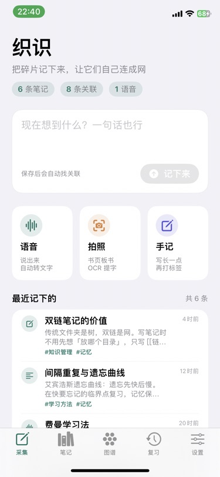
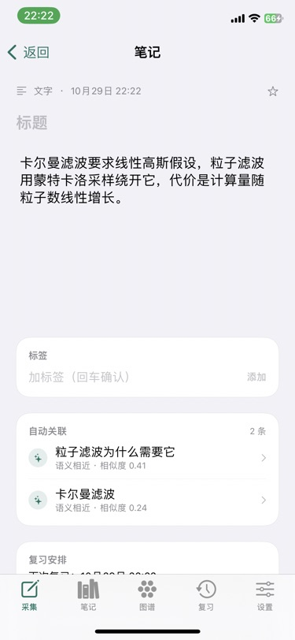
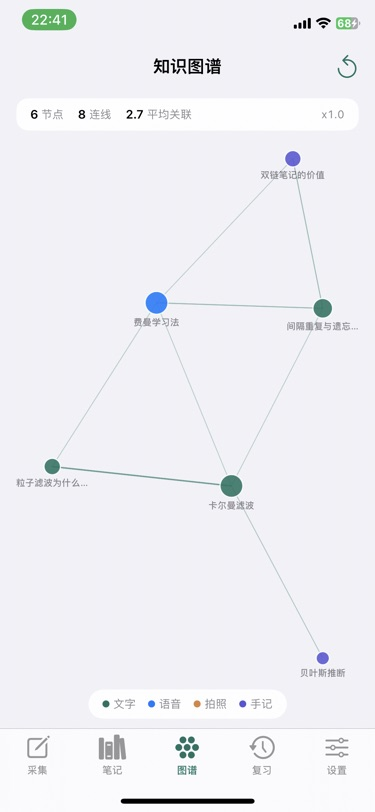
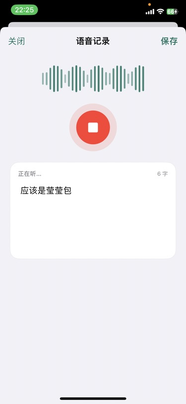
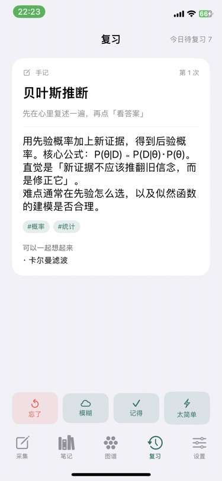

# 织识 Weave

> 用文字、语音、拍照快速记下工作和学习里遇到的陌生知识，让它们自动产生关联。

一个 iOS 原生小工具（SwiftUI，iOS 16+）。核心不是「记下来」，而是**记完之后自动连成网**：
新笔记保存的瞬间，本地算法会把它和已有的笔记比较语义距离、标签重合、时间邻近，
超过阈值就连一条边，在图谱里就能看见它挂到了哪儿。

---

## 截图

| 采集 | 笔记详情 | 知识图谱 |
|---|---|---|
|  |  |  |

| 语音实时转写 | 复习 |
|---|---|
|  |  |

> 以上均为 iPhone（iOS 16.7.16）真机截图，非模拟器。

## 它解决什么

学习时遇到的陌生概念是碎的：书上看到一句、会上听到一段、PPT 拍一张。
记完就散在备忘录里，过两周连自己写过都忘了。这个 App 做三件事：

1. **三种入口都要快**：语音实时转写、拍照 OCR 提字、纯文本快记，都是一步保存。
2. **不需要手动整理**：没有文件夹，没有目录树。保存即归类，归类靠关联。
3. **隔几天回来复习**：每条笔记自动生成一张复习卡，按 SM-2 排期。

## 功能

| 模块 | 说明 |
|---|---|
| 采集 | 文字快记 / 语音（系统 Speech 实时转写，中文）/ 拍照（点「拍照」直接进相机，Vision OCR，中英混排）|
| 自动关联 | 本地向量相似度 + 标签 Jaccard + 时间邻近，加权打分后取 Top-K |
| 知识图谱 | 力导向布局，节点大小按连接数，颜色区分来源，支持缩放拖拽点击 |
| 语义检索 | 除了关键词搜索，还能按「意思」检索（同一个向量空间） |
| 复习 | SM-2 四档评分（忘了 / 模糊 / 记得 / 太简单），自动排下次时间 |
| AI 增强（可选）| 填接口地址 + API Key 后，「模型」一行会自动从该地址的 `/models` 拉回**可用模型列表**供你挑选（不再写死），失败可手填；另有「测试连接」做真实探测 |
| 删除 | 笔记页左滑删除（红色）；首页最近列表长按可收藏/删除 |
| 导出 | Markdown，关联输出成 `[[双链]]`，可直接拖进 Obsidian |
| 示例数据 | 首启 6 条互相有关系的示例，图谱不是空的 |

## 技术选型

| 决策 | 选择 | 原因 |
|---|---|---|
| UI | SwiftUI | 单人可以快速把三层页面写完，图谱用 `Canvas` 直接画 |
| 持久化 | **Codable JSON 单文件** | 目标机是 iOS 16.7，SwiftData 用不了；Core Data 要 `.xcdatamodeld`，在没有 Xcode 的环境里无法校验。几百到几千条笔记全量读写完全够 |
| 向量化 | 自研 Hashing Trick（512 维）+ 次线性 TF + IDF + L2 归一化 | 不引入任何依赖、离线可用、跨进程确定性（用 FNV-1a 而非 `Hasher`） |
| 分词 | 中文单字 + 相邻二元组，拉丁按词 | 中文没有空格，二元组是性价比最高的近似 n-gram 方案 |
| 复习 | SM-2 简化版 | 比 FSRS 好解释，比固定间隔有效 |
| 依赖 | **零第三方依赖** | CI 不需要解析 SPM 依赖，构建更稳 |

### 关联打分公式

```
score = 0.68 × cos(向量a, 向量b)
      + 0.22 × Jaccard(标签a, 标签b)
      + 0.10 × max(0, 1 - 相距小时数 / 72)
```

超过阈值（默认 0.18，设置里可调）或语义相似度 ≥ 0.34 就连边，每条笔记最多连 6 条。
每次保存 / 编辑 / 删除都会整库重算一次 —— 数据量小，简单比聪明更重要。

## 构建

### 云端（推荐，不需要 Mac）

推到 GitHub 后，`.github/workflows/ios.yml` 会在 `macos-15` 上：

1. 装 `xcodegen`，从 `project.yml` 生成 `Weave.xcodeproj`
2. `xcodebuild archive` 出 **未签名** 的 `.xcarchive`
3. 把 `Weave.app` 塞进 `Payload/`，打成 `Weave-v1.0.0.ipa`
4. 上传 artifact

在 Actions 页面下载 `weave-unsigned-ipa` 即可。

### 本地（有 Mac + Xcode）

```bash
brew install xcodegen
./scripts/build_ipa.sh 1.0.0
```

或者直接 `xcodegen generate && open Weave.xcodeproj` 用 Xcode 调试。

## 装到手机上

未签名 IPA 必须由设备侧重新签名。三条路：

| 方式 | 前提 | 有效期 |
|---|---|---|
| TrollStore / TrollStore Lite | **越狱或支持 CoreTrust 的设备** | 永久 |
| Sideloadly / AltStore + 免费 Apple ID | Windows/Mac 都行 | 7 天，需重签 |
| 付费开发者证书 / TestFlight | 99 美元/年 | 1 年 |

走 TrollStore 的话，直接把 Release 里的 IPA 传到手机即可；也可以让手机自己下载安装
（先在本机起一个静态服务器，把 IPA 放在同目录）：

```bash
# 手机与电脑同一局域网
python -m http.server 8000
# 手机 Safari 打开，通过 TrollStore 的 URL 安装
# apple-magnifier://install?url=http%3A%2F%2F<你的局域网IP>%3A8000%2FWeave-v1.0.1.ipa
```

> 注意：`ldid` 伪签名 + `dpkg` 装进 `/var/jb/Applications` 虽然能启动，
> 但系统会按进程拦掉外网请求（`NSURLError -1009`），语音识别和 AI 增强都会失效。
> 走 TrollStore 安装才正常联网。

## 项目结构

```
Weave/
  App/          WeaveApp、RootView（五个 Tab）
  Models/       Note / NoteLink / ReviewCard（纯 Codable 值类型）
  Support/      AppStore（唯一数据源）、Theme、Exporter、SeedData、ImageTool
  Capture/      文字 / 语音（Speech）/ 拍照（Vision OCR）
  Linking/      分词、向量化、自动关联、LLM 增强
  Graph/        力导向布局 + Canvas 绘制
  Library/      列表、搜索、详情
  Review/       SM-2、复习界面
  Settings/     关联参数、AI 配置、导出、清库
Config/Info.plist
Assets/Assets.xcassets
project.yml     XcodeGen 配置（工程文件不入库）
```

## 参考过的开源项目

设计思路借鉴了这些项目，代码全部重写：

- [`rahulkarda/knowledge-graph-engine`](https://github.com/rahulkarda/knowledge-graph-engine) — 多模态采集 + 自动关联 + 语义搜索的整体骨架
- [`bwl/forest`](https://github.com/bwl/forest) — 图谱数据结构与自动打边的做法
- [`kermopajula/braindump`](https://github.com/kermopajula/braindump) — 纯端上、语音优先的隐私设计
- [`luisangel2895/neurova`](https://github.com/luisangel2895/neurova) — SwiftUI + 端上 OCR + 间隔重复的组合
- [`cutd/Anki-Flashcards-Pro`](https://github.com/cutd/Anki-Flashcards-Pro) — Anki 兼容的 SRS 调度实现

## 真机验证记录（v1.0.7）

iPhone（iOS 16.7.16，rootless 越狱）经 TrollStore Lite 安装后逐项走查：

| 项目 | 结果 |
|---|---|
| 安装与启动 | 未签名 IPA 经 TrollStore 安装，版本校验 1.0.7 通过 |
| 文字采集 → 自动关联 | 新增一条笔记后，关联数 8→10，自动连上 2 条既有笔记（相似度 0.41 / 0.24）|
| 语音实时转写 | 麦克风 + `SFSpeechRecognizer` 正常，实时出字、波形动画；停止后文字保留不丢 |
| 拍照 | 点「拍照」不再进中转页，直接落到系统相机；取消后停在拍照页，可改「从相册选」|
| 相册 OCR | 预览框固定 240 高、整图完整显示，点击可全屏看大图 |
| 知识图谱 | 力导向布局、节点按连接数变大小、来源配色、缩放拖拽；点节点直接打开详情（不再报「笔记已不在」）|
| 复习 | SM-2 四档评分生效，待复习 7→6，间隔按评分推进 |
| 模型列表 | 用本机起的 OpenAI 兼容模拟服务验证：`GET /v1/models` 返回 3 个模型 → App 正确列出「可用模型 3/3」并选中；「测试连接」返回「连接成功 · 23 ms · 模型回复「可用」」|
| 删除 | 笔记页左滑删除按钮为红色；首页列表长按菜单可收藏/删除，删完计数与提示同步 |
| 分享 / 持久化 | 系统分享面板正常；杀进程重启后数据完整（`Documents/weave-store.json`）|

> 首次进行网络请求时 iOS 会弹「允许使用无线数据」，需要允许一次，否则会报「似乎已断开与互联网的连接」。
> 连本地局域网模型（`http://192.168.x.x`）时还会弹一次「查找并连接本地网络上的设备」，同样需要允许；这两条权限的说明文案已写进 Info.plist。

## 已知限制

- 语音转写单段约 1 分钟，长录音需要分段（系统 `SFSpeechRecognizer` 的限制）
- 关联是「词面」相似度，不是真正的语义模型。同义不同词（如「滤波」与「filter」）需要靠 AI 增强补齐
- 全量 JSON 写入，笔记量到几万条会明显变慢；那时应该换 SQLite
- 图谱布局一次性算完，节点上千时会卡；目前按几十到几百个节点设计
- 没有 iCloud 同步，换设备靠导出 Markdown

## License

MIT
